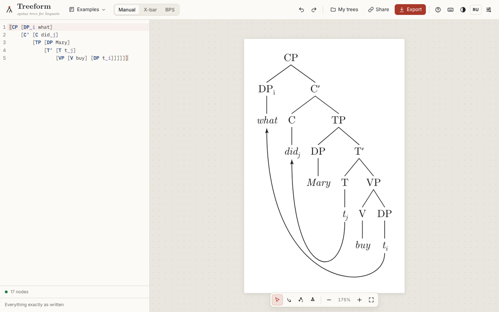
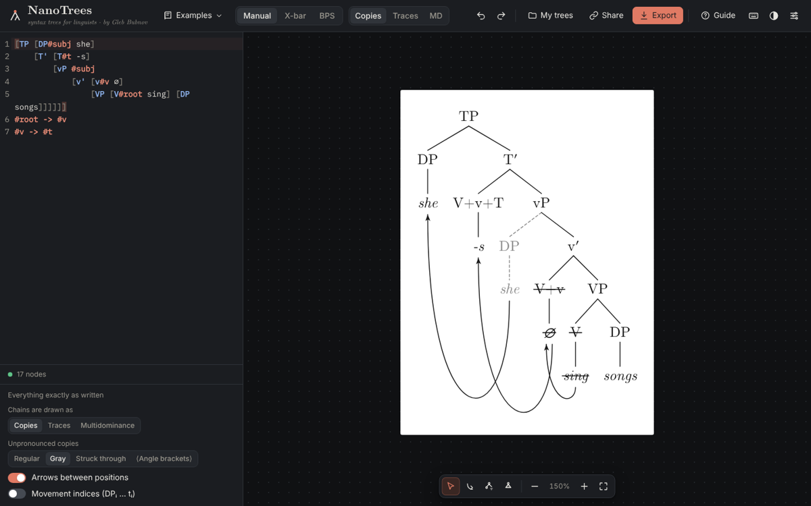

# NanoTrees — syntax trees for linguists

**[→ Open NanoTrees](https://interprole.github.io/tree/)** · by Gleb Bubnov

NanoTrees is an interactive editor for syntactic trees, for papers, slides and teaching. Write a tree in bracket notation and it redraws as you type. You can also edit on the picture: every change on the canvas is written back into the text. Export to SVG, PNG, PDF or LaTeX (`forest`, `tikz-qtree`, TikZ).



## Features

- **Bracket notation with live rendering.** Readable errors highlight their position, and the last valid tree stays on screen. Any Unicode works.
- **Typography close to a typeset paper.** Computer Modern, Libertinus, EB Garamond, Noto, a handwriting font, or any font installed on your computer. Real sub/superscripts, primes, small-caps glosses, feature stacks.
- **Labelling modes:**
  - *Manual*: as written.
  - *X-bar*: shorthand gets X′ levels filled in.
- **Movement chains.** A chain is one constituent in several positions (`[DP#wh what] … #wh`). It can be drawn three ways:
  - **copies**: unpronounced copies regular, gray, struck through or ⟨in angle brackets⟩;
  - **traces**: `t`;
  - **multidominance**: one node, several mothers.

  Several copies can be pronounced (`#wh!`), a copy can be pronounced with different words, with a gloss if you like (`#wh"whom"`, `#subj"zij | she"` for pronoun copying as in Wambeek Dutch), and a lower position can get its own meaning (`#wh$x : e$`, triggering Predicate Abstraction). Arrows for phrasal movement are drawn automatically and each can be edited; deleting one (keeping the movement) hides it. Movement indices are separate from the indices you type for binding.
- **Head movement.** An arrow between two heads strikes out the source and turns the target into a complex head written as text: the labels (V+v, V+v+T, T+C) and the words (sing+-s) are joined with +. No extra edges are drawn. The arrow itself can be hidden (one by one, or all head-movement arrows) while the movement stays.
- **Compositional semantics.** Write meanings as `$λx. cat(x) : <e,t>$` (or `lambda x.`, `iota x.`, `exists`, `forall`; numbers and comparisons work; types can be any names). The meanings of the other nodes are computed bottom-up with Functional Application, Predicate Conjunction, Event Identification and Function Composition. Type errors are shown at the node; the rule used can be shown or hidden, and meaning colours are configurable.
- **Several trees on one canvas.** Each tree has its own code, settings and place on the canvas (drag it by its name) and is exported on its own. A tree can be copied: an independent copy, or a linked copy that shares the code (edit one, both change) while its settings stay its own, e.g. copies in one and traces in the other.
- **Canvas editing** in an edit panel beside the canvas, so nothing covers the tree:
  - rename (the tree follows as you type), add daughters, sisters or a mother; copy, cut and paste a subtree as a copy of its own (Ctrl+C / X / V, Ctrl+D), also as a new tree; drag a branch by its root to move it; right-click menu; Shift + drag selects a branch;
  - linked branches (`;link=…`): copies of a branch, in one tree or in several, that change together inside while everything around them stays free (shown with a dashed frame); the code is laid out with line breaks and indentation as you go (also *Format*, Shift+Alt+F);
  - add an existing constituent again by clicking it (a new chain position);
  - triangles that keep the structure in the code;
  - features, meanings, notes next to a node (several, positioned automatically or by side, draggable);
  - colours of the label, the edge above, the whole branch (edges, labels and meanings) or the meaning, from the palette or any colour; edge width and length, spread of the daughters (changed at once with ▲▼, the arrow keys or the wheel);
  - arrows: line, head direction, reverse, colour, route, several labels at chosen sides (draggable), any number of bend points (double-click an arrow); an arrow can be *just an arrow* instead of head movement;
  - arrows leave and enter the node itself: at the side of a node with daughters, under a word; a head with only a word uses the word by default, or the node (`from=node`, `to=node`);
  - Markdown (`**bold**`, `*italic*`, `~~struck~~`) in labels, words, notes and arrow labels;
  - changing the branching of a node with two daughters (left ↔ right swaps them: `[XP X [Z]]` ↔ `[XP [Z] X]`);
  - click a note or an arrow label to rename or delete it, drag it to move it;
  - c-command and dominance highlighting;
  - undo and redo.
- **Export and sharing:**
  - SVG and PDF with embedded fonts, PNG up to 576 dpi;
  - LaTeX code, tested by compiling it with `pdflatex`, `xelatex` and `lualatex`;
  - save the canvas to disk (a `.nanotrees` file with all its trees; in Chrome and Edge Ctrl+S writes into the same file again, optionally on every change) and open it again;
  - share links, autosave in the browser, a list of saved trees.
- **Offline:** `npm run build:offline` makes `dist-offline/nanotrees.html`, the whole app in one file: open it by double-click, no internet needed.
- **Interface:** resizable panes (drag the borders); every setting can be reset on its own; light and dark themes; mobile layout; a built-in guide (button *Guide*).

## Bracket notation

| Write | Meaning |
|---|---|
| `[TP [DP the cat] [VP sleeps]]` | node = `[Label daughters…]`; words become terminals |
| `[ [D the] [N cat]]` | empty label |
| `**bold** *italic* ~~struck~~` | Markdown (escape with `\*`, `\~`) |
| `T'` `DP_i` `X^0` `\phi` `\0` | prime, subscript, superscript, φ, ∅ |
| `\Rightarrow` `\Leftrightarrow` `\varnothing` … | any standard LaTeX symbol command (exported back as the same command) |
| `[V liest \| read.PRS.3SG]` | gloss line under the terminal (ALL-CAPS → small caps) |
| `[T{uφ, iT, EPP} will]` | feature stack |
| `[DP ^the big cat]` / `[DP ^ [D the] [N cat]]` | triangle (over words / over a structure, which stays in the code) |
| `[DP@red …]`, `[DP@@#06c …]` | colour a node / its whole branch |
| `[DP;edge=red;width=2;len=20 …]` | colour / width / extra length of the edge above |
| `[VP;spread=30;sem=blue …]` | wider gaps between daughters; meaning colour |
| `[DP &"focus" &right"✓"@4,-2 …]` | notes next to the node (side, drag offset) |
| `[DP#wh what] … #wh` | a chain: the same constituent in two positions |
| `#wh!`, `[DP#wh? what]` | pronounce / silence a position |
| `#wh"whom"`, `#wh"zij \| she"`, `#wh$x : e$` | a position with its own words (and gloss) / meaning |
| `$λx_e.λe_s. agent(e)(x)$` | a meaning (optionally `: <type>`) |
| `#a -> #b dashed "label" above"x"@5,0 @red` | an arrow (after the tree) with labels; between heads it is head movement |
| `#wh/2 -> #wh/1 hide` | restyle or hide one automatic chain arrow |
| `#wh/2: ^ @gray {uφ} &"x" $x : e$` | one copy on its own: triangle, colour, features, note, meaning (also edge=, width=, len=, "words") — written on the constituent it goes to every copy |
| `#a -> #b plain` | just an arrow (what the arrow tool draws); Movement turns it into a chain or head movement |
| `[V#v;to=t sing]` | head movement of V to the head #t (V is struck through, T shows V+T) |
| `#v -> #t hide` / `visible` | the arrow of a movement hidden / shown against the switch for that kind of arrows |
| `#wh/2: open` · `#wh/2: @none` | this copy without the triangle / colour that all copies have |
| `#a -> #b via=0,40;-20,60` | bend points (px from the middle of the two ends) |
| `#a -> #b from=node to=node` | ends at the node instead of its word |
| `% comment` | comment to the end of the line |

Example: head movement, together with a subject chain.

```
[TP [DP#subj she]
    [T' [T#t -s]
        [vP #subj
            [v' [v#v ∅]
                [VP [V#root sing] [DP songs]]]]]]
#root -> #v
#v -> #t
```



## Semantics

Types can be anything: `e`, `t`, `s` (events), `d`, `n`, any other name, and `<a,b>`. A variable without a type is `e` (x, y, z), `s` (e, e′) or `<e,t>` (P, Q); write `λx_e.` to be explicit. For a node with two daughters, the first rule that applies is used:

| Rule | Applies to | Result |
|---|---|---|
| FA | ⟨a,b⟩ and a | ⟦β⟧(⟦γ⟧) |
| PC | two predicates of the same type | λa₁…aₙ. β(a…) ∧ γ(a…) |
| EI | ⟨e,⟨s,t⟩⟩ and ⟨s,t⟩ | λx.λe. β(x)(e) ∧ γ(e) |
| FC | ⟨b,c⟩ and ⟨a,b⟩ | λx. β(γ(x)) |

A daughter without any meaning below it counts as vacuous. If a moved phrase is sister to a node containing its own lower position with a variable meaning (`#q$x : e$`), that node is first abstracted over the variable (Predicate Abstraction, shown as PA+FA). If no rule applies, the node shows the failing types.

## LaTeX

The `forest` export is plain bracket code. Arrows and extra multidominance branches are TikZ `\draw` commands after the tree. Meanings and features are added as extra lines in the node. The test suite compiles every example in every format with `pdflatex`, and checks `xelatex` and `lualatex` as well.

Limitation: in `forest`, a multidominated node is written under one of its mothers; the other branches are drawn as straight lines. Use the *TikZ (exact layout)* export to reproduce the app's placement.

## Development

```sh
npm install
npm run dev          # http://localhost:5173/tree/
npm test             # unit tests (Vitest); LaTeX compilation runs when pdflatex + forest are installed
npm run build && npm run e2e          # Playwright tests
npm run build:offline                 # dist-offline/nanotrees.html: the whole app in one file, opens by double-click
npm run screenshots  # screenshots of all examples → screenshots/out
```

```
src/core/      no DOM, tested on its own
  parser.ts    bracket notation → AST with source spans and errors
  build.ts     AST → display tree: chains (copies/traces/MD), head movement, triangles, meanings
  modes.ts     X-bar projection
  semantics.ts typed λ-calculus, β-reduction, composition rules
  layout.ts    tidy layout, multidominance placement and routing
  arrows.ts    movement arrows
  scene.ts     drawing primitives → SVG, PNG, PDF
  latex.ts     forest / tikz-qtree / TikZ export
  edits.ts     canvas operations as minimal text edits
  format.ts    line breaks and indentation of the code
  analysis.ts  c-command and dominance
```

CI runs the type check, unit tests, LaTeX compilation and Playwright on every push, and deploys `main` to GitHub Pages.

## License

MIT © Gleb Bubnov. Bundled fonts (CMU Serif, Libertinus, EB Garamond, Noto, Caveat, STIX Two Math, IBM Plex Mono) are under the SIL Open Font License.
